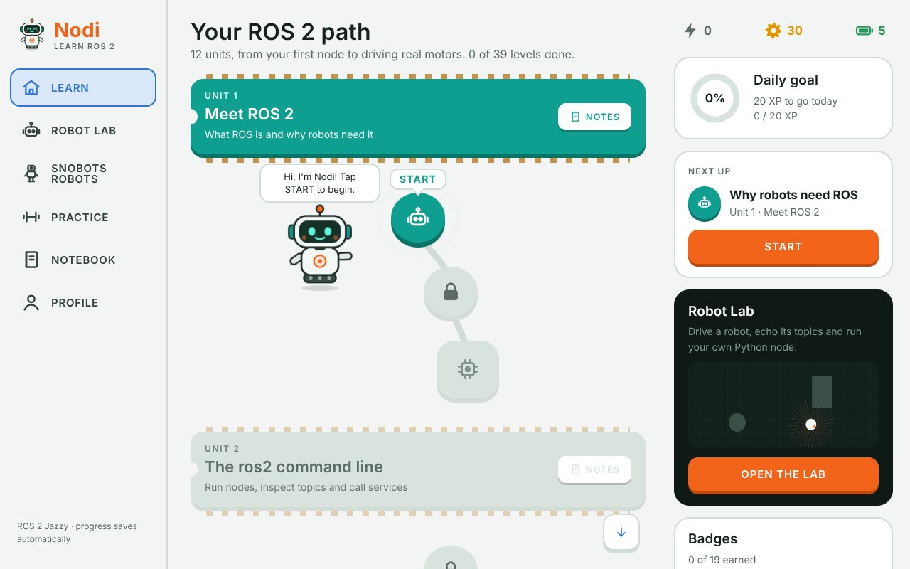
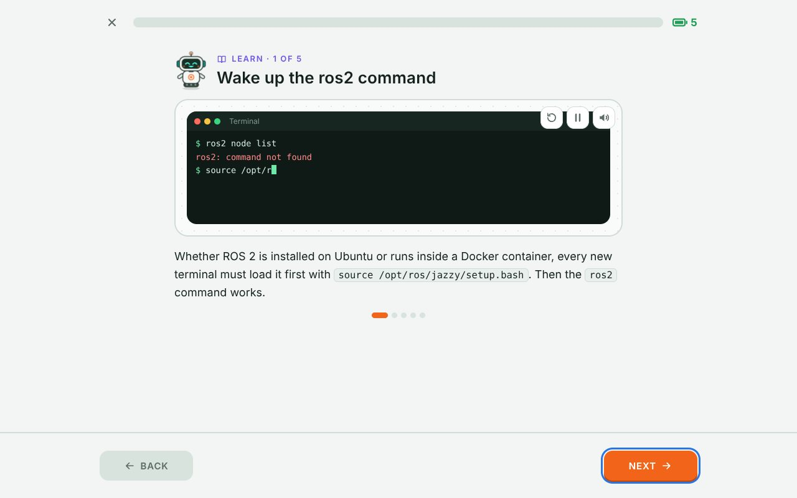
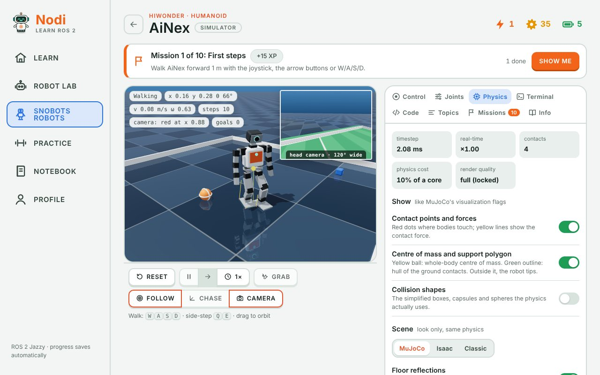
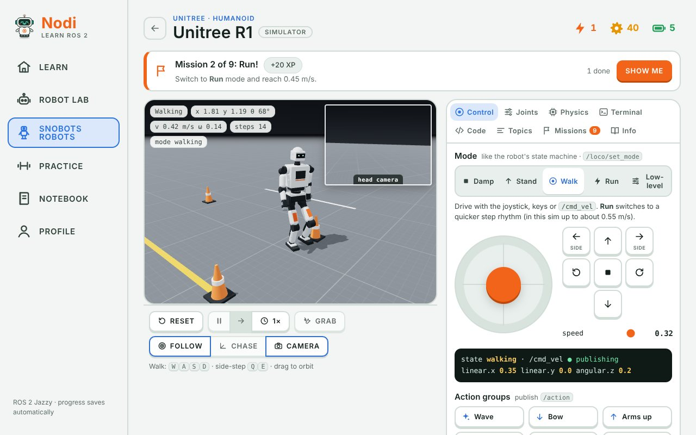
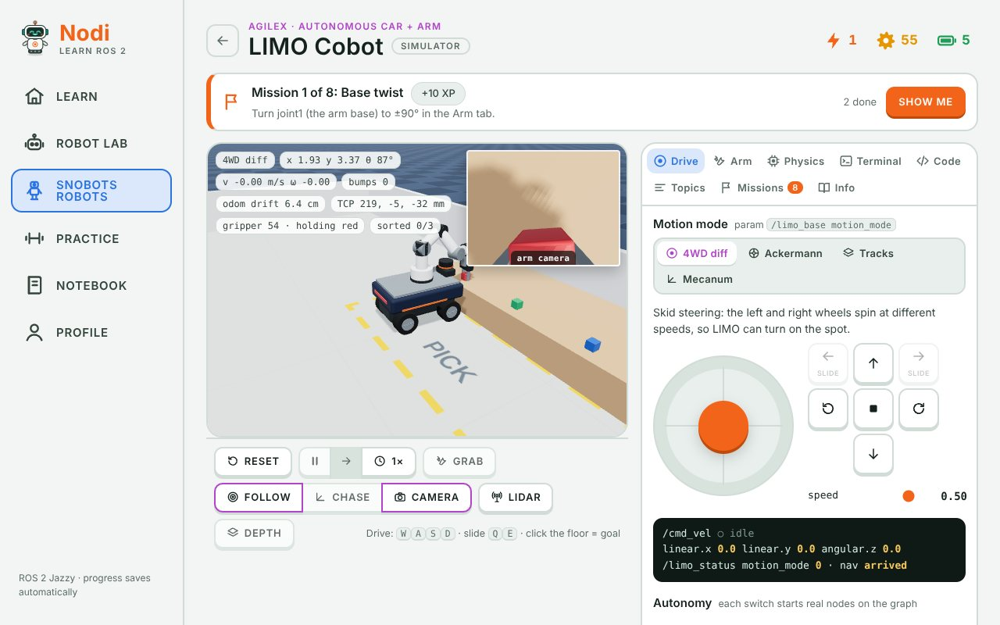
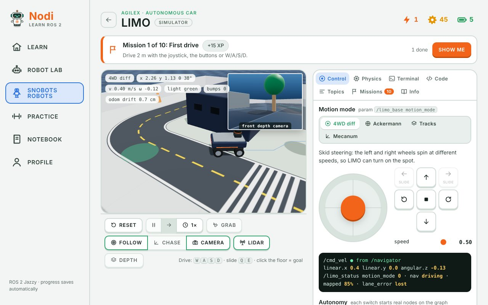
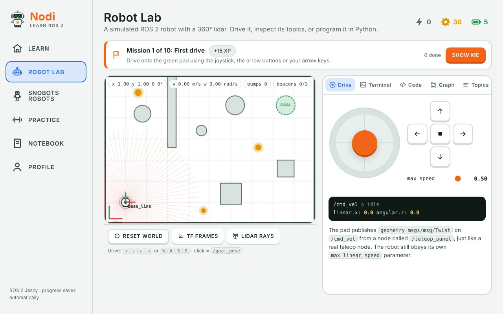
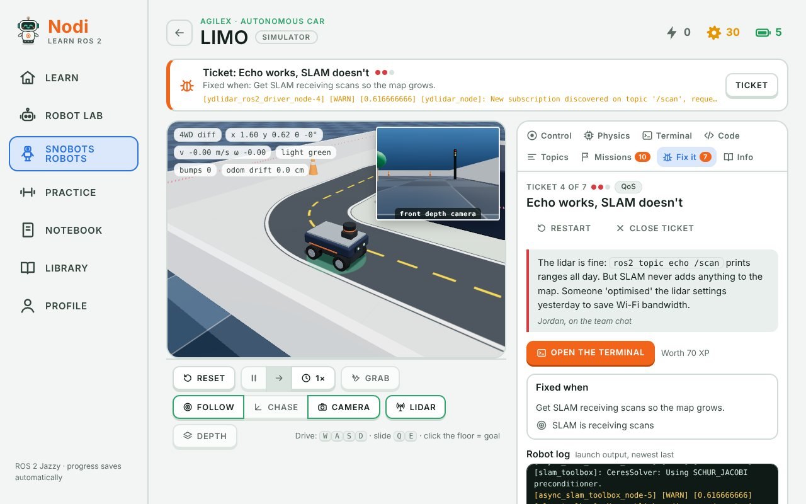
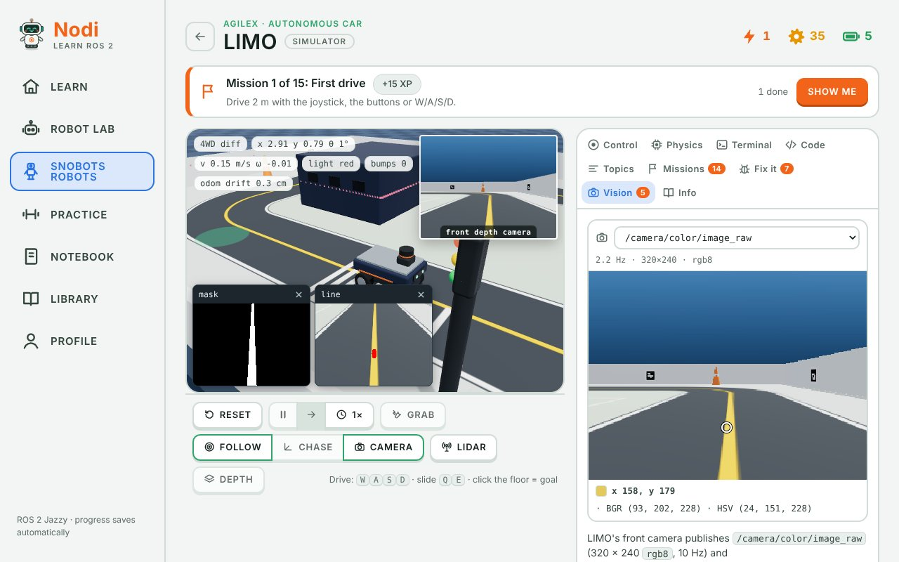
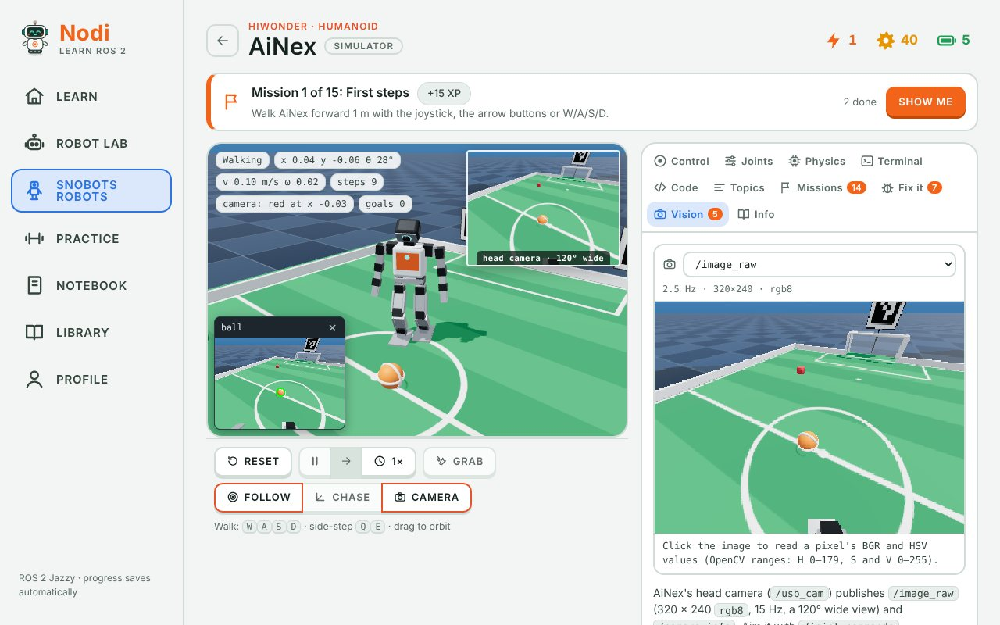

# Nodi: learn ROS 2 by playing

A game-like ROS 2 course that runs entirely in the browser, in a single web page. It has animated lessons, quick practice rounds, a 2D Robot Lab with a working `ros2` terminal and Python nodes, and **SnoBots Robots**: 3D physics simulators of four real robots.

**Try it:** https://pathinvyas.github.io/nodi-ros2/

| | |
|---|---|
|  |  |

## What's inside

| | |
|---|---|
| **Learn** | 12 units, 26 lessons and 153 exercises on ROS 2 Jazzy: the command line, publishers and subscribers, services, custom interfaces, parameters, launch files and TF2, in Python and C++, ending with a driver node for a microcontroller. Lessons are short animated scenes followed by a mix of exercise types (multiple choice, fill in the code, spot the bug, order the steps, drive the turtle). |
| **Robot Lab** | A 2D robot with a live ROS 2 graph. Use `ros2 topic echo`, `ros2 param set` and friends in the terminal, or write Python nodes with an rclpy-style API. Python runs in your browser through Pyodide. |
| **SnoBots Robots** | Physics simulators of a Hiwonder AiNex (24-joint small humanoid), a Unitree R1 (humanoid), an AgileX LIMO (four wheel modes) and a LIMO Cobot (LIMO with a 6-axis arm). Each has missions, a terminal, a Python code tab and a live topic graph. LIMO and AiNex also have **broken-robot missions** (tickets where the robot starts with a fault that you fix with `ros2` commands) and a **Vision lab** (a simulated camera and OpenCV in Python). |
| **Library** | Books and guides to read inside the app. It has a PDF reader with search (every match highlighted on the page, plus a results list), a contents panel, zoom, selectable text and a saved place in every book. Readers can also open their own PDFs, which stay in their browser. |
| **Practice, Notebook, Profile** | Review rounds, unit notes, XP, streaks and badges. Progress is saved in the browser. |



| | |
|---|---|
|  |  |
|  |  |

## The physics

The simulators run on a small rigid-body engine written for this project, in the spirit of MuJoCo (it is not MuJoCo itself):

- **Articulated dynamics.** Featherstone's recursive Newton–Euler algorithm gives the bias forces and the composite-rigid-body algorithm gives the mass matrix. Every link has mass and inertia.
- **Motors.** Joints are driven by implicit PD servos with torque and speed limits, rotor armature, damping and friction, so a robot can sag, stall or fall.
- **Contacts.** Boxes, spheres, capsules and wheels touch through soft contacts with Coulomb friction and rolling resistance. They are solved with warm-started projected Gauss–Seidel. Mecanum rollers use anisotropic friction.
- **Walking.** The humanoids use a model-based controller: a footstep planner, a linear-inverted-pendulum / DCM centre-of-mass plan, capture-point stepping to catch pushes, and leg inverse kinematics. A virtual hoist stands them up after a fall.
- **Wheels and sensors.** LIMO's `/odom` is integrated from the wheel encoders, so it drifts when the tyres slip, and SLAM or navigation publish the `map → odom` correction. The IMU and odometry have noise.
- **Tools you'd expect from a physics sim.** Pause and single-step, slow motion, Ctrl+drag to push a robot or an object, overlays for contact forces, centre of mass and collision shapes, domain randomization (friction, mass, payload, motor strength, sensor noise), and MuJoCo-, Isaac- and classic-style scenes.
- **Simulated time.** Python nodes in the simulators run on the simulator's clock (`use_sim_time` is true), and message stamps carry simulated seconds, so pausing the sim pauses your timers too.

Honest limits: the real Unitree R1 walks with a learned (reinforcement-learning) policy, not this controller, and the topic names are simplified for teaching. Always follow the vendor documentation before running code on real hardware.

## Broken-robot missions

LIMO and AiNex each have a **Fix it** tab with seven tickets. Each one restarts the robot with a real fault in its ROS graph and a bug report from a teammate. There is no button that fixes it: you find the cause and fix it in the terminal, as you would on a real robot.



| Ticket | The fault | What you practise |
|---|---|---|
| The map won't grow | the lidar driver crashed at start-up | `ros2 node list`, `ros2 topic info`, `ros2 run` |
| LIMO is crawling | `max_linear_speed` left at 0.08 m/s | `ros2 param get/set`, double vs integer |
| LIMO ignores the joystick | the base still has a remap from a two-robot demo | `ros2 node info`, remapping, `topic_tools relay` |
| Echo works, SLAM doesn't | the lidar publishes best effort, SLAM wants reliable | `ros2 topic info --verbose`, QoS overrides |
| Where is the lidar? | nothing publishes `base_link → laser_link` | `tf2_echo`, `/tf_static`, `static_transform_publisher` |
| Two names for one lidar | scans say `frame_id: laser`, the tree says `laser_link` | `header.frame_id`, read-only parameters |
| Same topic, different language | the joystick sends `TwistStamped`, the base wants `Twist` | `ros2 topic list -t`, message types |

AiNex's tickets are about its head camera, its vision nodes and its walking controller. Its bringup starts `robot_state_publisher`, the walking controller, the `usb_cam` driver, a colour detector and a ball locator (which turns the ball's pixel into a point on the floor through TF).

| Ticket | The fault | What you practise |
|---|---|---|
| AiNex is blind | the camera driver crashed at start-up (`/dev/video0` was not there yet) | `ros2 node list`, `ros2 topic info`, `ros2 run` |
| Head tracking ignores the red block | the detector's `min_area` was raised far too high | `ros2 topic echo`, `ros2 param get/set` |
| AiNex trips over its own feet | `step_height` lowered to 8 mm, so the swinging foot scuffs the floor | gait parameters, `ros2 param dump` |
| Pictures, but nobody looks | the camera still has remaps from a two-robot demo | `ros2 node info`, remapping, `topic_tools relay` |
| Echo sees pictures, the detector does not | the camera publishes best effort, the detector wants reliable | `ros2 topic info --verbose`, QoS overrides |
| Where is the ball? | images stamped `frame_id: camera`, a frame the tree doesn't have | `header.frame_id`, optical frames, `static_transform_publisher` |
| AiNex won't walk from the joystick | the joystick sends `TwistStamped`, the controller wants `Twist` | `ros2 topic list -t`, message types |

This works because the simulated graph follows the same rules as ROS 2: the robot's own nodes are processes you can stop and start again with `--ros-args -r … -p …`, a parameter of the wrong type crashes a node, publishers and subscriptions with incompatible QoS never connect (and warn once, like DDS discovery), latched `/tf_static` keeps each publisher's transforms, and the TF tree only contains frames that someone is actually publishing. A ticket checks the live simulation, so any fix that really works counts. Hints cost XP.

## The Vision lab

LIMO and AiNex each have a camera, published the way a ROS 2 camera driver publishes it, and the Python tab runs OpenCV. The **Vision** tab is a small image viewer: pick any `sensor_msgs/Image` topic, then click a pixel (or use the arrow keys) to read its BGR and OpenCV HSV values, which are the numbers `cv2.inRange` needs.

- **OpenCV in Python.** `import cv2` loads OpenCV 4.10 (with the `aruco` module) and NumPy into Pyodide. The first run downloads about 15 MB, and the browser caches it after that. `cv_bridge.CvBridge` converts images both ways (`rgb8`, `bgr8`, `mono8`, `mono16`, `32FC1` and more), and `cv2.imshow` opens a small window over the 3D view (`cv2.waitKey` returns -1, as it does with no key pressed).
- **Lazy cameras.** A camera renders the 3D scene from its pose in the TF tree, stamped on the sim clock, but only while a node wants the pixels, so `ros2 topic hz` and `ros2 topic bw` start it like any other subscriber. Both are ideal pinholes: `camera_info` has the real intrinsics `K` and no distortion.
- **Checked from the world.** Like the Fix it tickets, the missions check the true state of the world (where the robot and the ball really are), and only count when your node is in charge.

### LIMO



The `/camera/camera` node publishes `/camera/color/image_raw` (320×240 `rgb8`, 10 Hz, a 56° vertical field of view) and `/camera/color/camera_info`, in `camera_color_optical_frame`. `color_fps` and `enable_color` are parameters. Around the arena: the yellow centre line, five ArUco markers (`DICT_4X4_50`, 12 cm) on the walls and a kiosk, and a red and a magenta ball that roll when LIMO pushes them.

| Mission | What you do | Starter code |
|---|---|---|
| Camera check | measure the image rate with `ros2 topic hz` and read the intrinsics from `camera_info` | |
| Follow the yellow line | an HSV mask and image moments steer LIMO 4 m along the centre line | line follower |
| The magenta ball | change the colour tracker's thresholds so it stops 20–50 cm from the magenta ball | colour tracker |
| Marker reader | detect ArUco markers and publish four different IDs on `/marker_id` | marker reader |
| Dock at marker 7 | use `solvePnP` to park the camera 0.5 m in front of marker 7, square to it | marker reader |

### AiNex



The head camera is a `usb_cam` driver: `/image_raw` (320×240 `rgb8`, 15 Hz) and `/camera_info`, in `camera_optical_frame`, through a 120° (diagonal) wide-angle lens. Your node aims it with `head_pan` and `head_tilt` on `/joint_commands`. On the pitch: the orange ball, three coloured blocks, and ArUco tags (`DICT_4X4_50`, 15 cm) on posts, plus a 20 cm tag 0 above the goal. Look down too far and the camera sees AiNex's own orange chest, which a careless colour filter will chase.

| Mission | What you do | Starter code |
|---|---|---|
| Camera check | measure the image rate with `ros2 topic hz` and read the intrinsics from `camera_info` | |
| Watch the ball | turn the head to keep the orange ball in the middle of the picture while AiNex walks | ball tracker (head) |
| Walk to the ball | find the ball, turn to it and walk until it is 10–25 cm in front | walk to the ball |
| Tag reader | detect ArUco tags around the pitch and publish three different IDs on `/marker_id` | tag reader |
| Vision striker | line up with the goal and score from a kick your node asks for on `/action_group` | walk to the ball |

## The Library

The Library shelf is defined in `src/library.js`. A book can be in one of two forms:

- **Shipped with the app.** The PDF lives in `library/` and is published with the site. Only add PDFs you have the right to share publicly, for example your own guides or openly licensed books.
- **Bring your own copy** (`own: true`). This is for copyrighted books. The shelf shows the title and a link to the publisher, and each reader adds their own PDF from their device. It's kept in that browser's storage (IndexedDB) and never uploaded.

To add a shipped book:

1. Copy the PDF into `library/`.
2. Add an entry to `LIBRARY` in `src/library.js`.
3. Optionally, add a cover image in `library/covers/` and refer to it as `'LIBCOVER:<file>'`.

The build inlines covers and copies the PDFs next to `index.html`. `npm test` checks that every listed file exists and is a PDF.

To add a bring-your-own-copy book, add an entry with `own: true`, the publisher (`pub`), a `link` to the publisher's page and a cover `color`. The shelf draws its cover from those. Don't put the book's PDF anywhere in the repository; `npm test` fails if such an entry names a file.

The reader uses [PDF.js](https://mozilla.github.io/pdf.js/), loaded from a CDN when you first open a book.

## Run it locally

You need Python 3 to build. The page loads three.js and Pyodide from public CDNs, so the 3D view and Python need an internet connection.

```bash
python3 build.py                        # inlines src/ into dist/index.html
python3 -m http.server -d dist 8000     # then open http://localhost:8000
```

## Tests

The tests run the real simulator code in Node.js (version 18 or newer), without a browser:

```bash
npm test
```

- `tests/content.test.js` checks the course data: every lesson scene and every exercise answer key.
- `tests/physics.test.js` checks the engine against textbook answers: resting contact, Coulomb sliding distance, rolling without slipping, free fall of an articulated body, pendulum period.
- `tests/library.test.js` checks the Library list: shipped books are real PDFs with their covers, and bring-your-own-copy books ship no file.
- `tests/fix.test.js` opens every broken-robot ticket, checks that its fault is really there, and applies the fixes a ROS developer would try (restarting a node, `param set`, a relay, a static transform). It also checks the QoS, message-type and latching rules the tickets rely on, and that near misses (a transform 9 cm off, driving with `topic pub`) don't count.
- `tests/vision.test.js` checks LIMO's camera and vision missions: `camera_info` matches the field of view, the optical frame points z forward, images are only rendered while someone subscribes, the ArUco codes match OpenCV's, the pixel picker's HSV matches `cv2.cvtColor`, the starter thresholds catch the right colours, and each mission counts only when your node does the job.
- `tests/ainex_lab.test.js` checks AiNex as a ROS graph: its bringup, a TF tree that only holds published frames, and a camera that renders only for real subscribers while still feeding the robot's own vision nodes. It opens all seven AiNex tickets and fixes each one the usual ways (including the wrong bridge that a ticket must catch), and checks the five vision missions, the starter colour thresholds and the tag codes.
- `tests/robots.test.js` drives the four robots:
  - AiNex stands, walks, turns, kicks, catches a push and is stood back up after a hard one
  - R1 walks at 0.4 m/s, collapses in damping mode and holds a joint in low-level PD mode
  - LIMO drives in all four wheel modes, with odometry that slips against a wall
  - LIMO navigates to a goal
  - the Cobot picks and sorts all three cubes

## Project layout

```
build.py            one-file build: src/ -> dist/index.html
src/
  core.js           app state, storage, UI helpers, icons
  anim.js           lesson animations
  content1.js       course content: units, lessons, exercises, notes
  content2.js
  lesson.js         lesson player and exercise types
  lab.js            Robot Lab: 2D robot, ROS 2 graph, terminal, Python runner
  pyworker.js       Pyodide web worker
  pyshim.py         rclpy-style API for the browser
  sno_kin.js        kinematic trees, forward and inverse kinematics
  sno_phys.js       the rigid-body physics engine
  sno_walk.js       biped walking controller (LIPM / DCM)
  sno_core.js       SnoBots 3D view, panels, physics tools
  sno_humanoid.js   humanoid models and simulator
  sno_robots.js     AiNex (its bringup, camera, vision nodes and missions) and R1
  sno_car.js        LIMO and LIMO Cobot
  sno_defs.js       robot definitions, missions, code templates
  sno_fix.js        broken-robot missions (Fix it tickets)
  sno_vision.js     Vision tab: image viewer, pixel picker, cv2.imshow windows
  library.js        Library shelf and PDF reader
  app.js            pages and routing
  styles.css        app styles
  sno.css           SnoBots styles
  library.css       Library and reader styles
library/            PDFs published with the app, and their covers
tests/              Node tests (see above)
docs/screenshots/   images for this README
```

## Notes

- The **Ask Nodi** tutor and cloud-synced progress use features of the Claude artifact viewer. Hosted anywhere else, such as GitHub Pages, the tutor is hidden and progress stays in the browser.
- The SnoBots simulators are unofficial educational simulators, made for learning. They are not affiliated with or endorsed by Hiwonder, Unitree, AgileX or Elephant Robotics. Robot names belong to their owners. Models are simplified and behaviour is approximate.
- Third-party code loaded at runtime: [three.js](https://threejs.org) (MIT), [Pyodide](https://pyodide.org) (MPL-2.0), [PDF.js](https://mozilla.github.io/pdf.js/) (Apache-2.0), and fonts from Google Fonts (SIL Open Font License). When a Python node imports them, [OpenCV](https://opencv.org) (Apache-2.0) and [NumPy](https://numpy.org) (BSD-3-Clause) come from Pyodide's package repository.
- *Patty's Guide to GitHub* in `library/` is by Pathin and is published with the app.
- The textbooks on the shelf (*Introduction to Autonomous Mobile Robots*, *Robot Modeling and Control* and *A Concise Introduction to Robot Programming with ROS2*) are copyrighted by their authors and publishers. Nodi doesn't include them. It lists each one with a link to its publisher, and readers add their own copies.

## License

MIT. See [LICENSE](LICENSE).
